# RK3568 端侧实时目标检测 + 硬件编码低延迟推流

在 LubanCat（Rockchip RK3568）单板计算机上实现的完整端侧 AI 视觉流水线：

**OV8858 MIPI 摄像头 → RK3568 NPU（YOLOv8n int8 量化）实时识别（中文标签）→ VPU 硬件 H.264 编码 → 板端 RTSP 服务器 → 手机 VLC / PC ffplay 低延迟拉流**

全流程不依赖云端，检测框在板端叠加后进编码器，客户端拿到的画面自带检测结果。端到端跑满摄像头 30fps，支持多客户端同时拉流（有线 / WiFi / 手机热点均可）。

---

## 一、系统架构

```mermaid
flowchart LR
    A[OV8858 摄像头<br/>MIPI-CSI / rkisp] -->|V4L2 YUYV| B[采集线程]
    B -->|最新帧| C[主循环<br/>画框 + 推流]
    B -->|最新帧 copy| D[推理线程<br/>letterbox 640x640]
    D -->|RKNNLite inference| E[RK3568 NPU<br/>YOLOv8n int8]
    E -->|output tensors| F[numpy 后处理<br/>dfl + NMS]
    F -->|bbox / scores / classes| C
    C -->|BGR appsrc| G[videoconvert<br/>BGR→NV12]
    G --> H[mpph264enc<br/>VPU 硬件 H.264]
    H --> I[h264parse]
    I --> J[rtph264pay<br/>mtu 1200 / zero-latency]
    J -->|UDP| K[PC 端 ffplay<br/>低延迟软解码]
```



采集 / 推理 / 推流三个线程全并行，主循环永不等待推理 —— 这是能跑满 30fps 的关键。

---

## 二、性能数据（实测）

| 版本      | 流水线结构                      | 实测帧率                  | 说明                                   |
| ------- | -------------------------- | --------------------- | ------------------------------------ |
| v1      | 单线程串行：采集→推理→画框→推流 环环等待     | 9.9 fps               | 采集被推理阻塞，伴 `cap_v4l select() timeout` |
| v2      | 采集独立线程 + 主循环内同步推理隔帧节流      | 19.1 fps              | 推理仍阻塞主循环                             |
| v2.1 诊断 | `--no-infer`（关闭 NPU）       | **30.2 fps**          | 证明采集 / 硬编 / 网络都不是瓶颈                  |
| v2.1 诊断 | `--width 640 --height 480` | 18.5 fps              | **降分辨率零改善** → 瓶颈是固定推理耗时              |
| **v3**  | **三线程全并行，推理独立线程**          | **≈30 fps**（受摄像头上限约束） | 画面满帧，检测框约 10fps 刷新                   |

### RTSP / 多客户端阶段（v3 之后）

| 场景                | 配置                     | 实测                              | 说明                         |
| ----------------- | ---------------------- | ------------------------------- | -------------------------- |
| 有线（校园网/直连）        | 1024×768@30，2.5Mbps    | **stream 29.4 fps / infer 9.9** | 系统负载 0.33，CPU 38°C，持续稳定    |
| 手机热点（2.4GHz WiFi） | 640×480@20，1.2Mbps，TCP | stream 19.8 / infer 10.4        | 信号 -47dBm / 72Mbps 链路下满速发送 |
| 手机热点降档            | 640×480@12，500kbps     | stream 11.9                     | 延迟 <1s，观感与帧率权衡             |

> 排障方法同样可复用：`--no-infer` 关掉 NPU 做 A/B 对照 → 若仍然卡，瓶颈必在传输链路而非算力。本项目最终确认 iPhone 热点（2.4GHz + 省电调度）是手机端卡顿的根因，板端发送侧全程满速无丢帧。

### 瓶颈定位过程（本项目最有价值的工程经验）

1. v1 只有 9.9fps，直觉怀疑 NPU 慢 —— 但 RK3568 跑 YOLOv8n int8 640×640 单帧约 25~35ms，理论该有 30fps，解释不了 101ms/帧。
2. 加分段诊断开关（`--no-infer` / `--no-stream` / `--bench`）测三段上限：`--no-infer` 跑满 **30.2fps** → 采集、编码、网络全无问题。
3. 再测 640×480：**18.5fps，与 1024×768 几乎一致**。分辨率砍半帧率不变 → 瓶颈是**固定成本的单次推理链**（letterbox + NPU + numpy 后处理 ≈ 100ms），不是像素搬运量。
4. 结论：问题不在算力，在**结构** —— 同步推理卡住主循环。改为推理独立线程后主循环只做「画框 + 推流」，帧率回到 30fps。

> 教训：性能问题先分段测量再动手改。靠猜（降分辨率、调码率）两次都猜错了。

---

## 三、软硬件栈

| 层   | 组件                                                     | 说明                                |
| --- | ------------------------------------------------------ | --------------------------------- |
| 硬件  | LubanCat RK3568（四核 A55 @1.8GHz，NPU 0.9 TOPS）           | OV8858 MIPI-CSI 摄像头               |
| 系统  | Debian 12 bookworm，Linux 6.1.99                        |                                   |
| NPU | RKNPU 驱动 0.9.8，**DRM render 节点 `/dev/dri/renderD129`** |                                   |
| 推理  | rknn-toolkit-lite2 2.3.0 + `librknnrt.so` 2.3.0        | 三者版本必须对齐                          |
| 模型  | YOLOv8n，**int8 量化**，640×640，4.6MB                      | fp32 ONNX 约 12MB                  |
| 编码  | `mpph264enc`（RK3568 VPU 硬件 H.264）                      | rockchip-linux/mpp + gst-rockchip |
| 传输  | RTP over UDP，MTU 1200，aggregate-mode=zero-latency      | 板子与 PC 网线直连                       |
| 解码  | PC 端 ffplay / avdec_h264 软解                            |                                   |

---

## 四、关键技术点与踩过的坑

1. **6.1 内核的 RKNPU 走 DRM 框架**：节点是 `/dev/dri/renderD(128+minor)` = **renderD129**，不存在 `/dev/rknpu`。网上大量教程仍写 `/dev/rknpu`，是老内核的形式。验证方式：`ls -l /dev/dri/by-path/ | grep npu`。
2. **版本三方对齐**：PC 端 rknn-toolkit2、板端 rknn-toolkit-lite2、`librknnrt.so` 必须同为 2.3.0，否则 `load_rknn` 直接失败。
3. **官方例程的 4 个坑**（板端独立运行时必踩）：
   - `yolov8.py` 用 `realpath.index('rknn_model_zoo')` 定位仓库根 → 传到板子必须保留官方目录结构；
   - `py_utils/rknn_executor.py` 写死 `from rknn.api import RKNN`（PC 完整版），板端必须改成 `from rknnlite.api import RKNNLite as RKNN`，且 `init_runtime()` 不能带 target；
   - RKNNLite 要求显式 **4 维 NHWC** 输入（`np.expand_dims(img, 0)`），3 维会报 "need 4dims input"；
   - 后处理 `dfl()` 官方用 torch 写，板端无 torch → 改为纯 numpy 实现（减最大值 softmax + 位置索引加权和）。
4. **硬编码缓冲池协商**：`mpph264enc` 会向 v4l2src 提议 MPP DMABUF 分配器，而 rkisp 不支持 dmabuf-import → `Buffer pool activation failed`。做法是在 `gstmppenc.c` 的 propose_allocation 里注掉该段，改走 memcpy 路径，仍足够 30fps。
5. **绝不使用 `io-mode=dmabuf`**：会死锁 rkisp 驱动，Ctrl+C 无效，只能 reboot。
6. **分辨率约束**：必须 16 字节对齐且符合 ISP 步进（1632×1216 / 1280×960 / 1024×768 已验证）。
7. **低延迟参数组合**：`queue max-size-buffers=1 leaky=downstream`、`rtph264pay mtu=1200 aggregate-mode=zero-latency`、`udpsink sync=false async=false`，接收端 ffplay 配 `-fflags nobuffer -flags low_delay -framedrop`。

---

## 五、更换识别目标

### 方式 A：只筛选关心的类别（零成本）

模型输出 80 类，如果只关心其中几种，在 `draw_boxes()` 里加过滤即可，不需要重新训练。

### 方式 B：换现成的其他模型

```bash
# PC 端：转换（i8 = int8 量化，rk3568 = 目标平台）
python3 ~/rknn_model_zoo/examples/yolov8/python/convert.py \
    ../model/yolov8s.onnx rk3568 i8 ../model/yolov8s.rknn
```

```bash
# 板子端：指定模型路径
python3 ~/npu_stream.py --model ~/rknn_model_zoo/examples/yolov8/model/yolov8s.rknn
```

### 方式 C：自训练模型，识别专属目标（如安全帽 / 灭火器）

```bash
# PC 端：1) 标注数据（YOLO 格式 txt）  2) 训练
yolo detect train data=my_data.yaml model=yolov8n.pt epochs=100 imgsz=640

# PC 端：3) 导出 ONNX
yolo export model=runs/detect/train/weights/best.pt format=onnx opset=11

# PC 端：4) 转 RKNN —— 量化校准必须用【自己的】图片，否则精度会暴跌
python3 convert.py best.onnx rk3568 i8 best.rknn
```

```bash
# 板子端：5) 提供自己的类别文件，一行一个名字
python3 ~/npu_stream.py --model ~/best.rknn --classes ~/my_classes.txt
```

`my_classes.txt` 示例：

```
安全帽
未戴安全帽
灭火器
```

> 关键点：int8 量化在校准阶段需要**代表性数据集**。换成自定义目标后如果仍用 COCO 图校准，量化参数不匹配，精度会明显下降。

---

## 六、中文标签

OpenCV 的 `cv2.putText` **不支持中文**（会渲染成问号），必须改用 **PIL + CJK 字体**。脚本已内置该能力，默认 `--lang zh`。

```bash
# 板子端：安装中文字体与 PIL
sudo apt install -y fonts-noto-cjk python3-pil
```

实现要点：整帧只做一次 BGR→RGB→BGR 转换（逐框转换会明显变慢），所有文字用 `ImageDraw.text()` 一次性画完；字体缺失时自动回落英文标签，不会崩。

切换英文：

```bash
python3 ~/npu_stream.py --lang en
```

---

## 六点五、RTSP 服务器版（rtsp_stream.py）

在 `npu_stream.py` 基础上，把末端 `udpsink` 换成 **GstRtspServer 的 RTSPMediaFactory**，板子本身成为一台 RTSP 服务器：客户端（VLC / ffplay / 手机）主动拉流，支持多客户端共享同一条编码管线。

```bash
# 板子端：启动（WiFi/手机热点场景一键预设：640x480@20 1.2M TCP + 关WiFi省电 + 限速）
python3 ~/rtsp_stream.py --wifi

# 任意客户端拉流（打印出来的地址直接用）
ffplay -fflags nobuffer -flags low_delay -framedrop rtsp://<板子IP>:8554/live
```

依赖：`sudo apt install -y gstreamer1.0-rtsp gir1.2-gst-rtsp-server-1.0 python3-gi`

### 实现要点

- factory 的 launch 串**必须以 payloader 结尾并命名为 `pay0`**，整体括号包裹；
- `set_shared(True)` → 多客户端共享同一条编码管线，只编码一次；
- appsrc 在 **media-configure 回调**里通过 `media.get_element().get_by_name('src')` 获取（客户端接入时才创建）；
- RTSP 依赖 GLib 主循环 → 放后台线程，主循环继续采帧推帧。

### 三个经典实时流问题（本项目实战修复）

| 问题              | 根因                                                  | 修复                                                                           |
| --------------- | --------------------------------------------------- | ---------------------------------------------------------------------------- |
| 多客户端切换后**黑屏**   | 切换瞬间 media 短暂 PAUSE，主循环无脑推帧 → 旧帧堆积，解码器收到时间戳混乱的帧全部丢弃 | 推帧前 `appsrc.get_state(0)` 检查，仅 `PLAYING` 才推                                  |
| **十几秒延迟**       | appsrc `max-bytes` 默认 0（无上限），客户端消费慢时旧帧无限堆积          | **背压**：`max-bytes` 限 2 帧 + `need-data/enough-data` 信号控制投喂                    |
| WiFi 下**卡顿/抖动** | rtl8188f 省电模式周期性休眠 + UDP 丢包                         | `iw dev wlan0 set power_save off` + RTSP over TCP + 短 GOP + 主循环按目标帧率限速（超帧丢弃） |

### 调试经验：先测发送侧，再怀疑链路

- 板端每 5 秒打印 `stream fps | infer fps`，发送侧满速（如 19.8/20）说明板子无问题；
- 配合 `top`（系统负载）与 `iw dev wlan0 link`（信号强度/速率）三个数据即可把瓶颈锁死在 板端 CPU / 无线链路 / 客户端 三者之一；
- 手机端 VLC：网络缓存调到**最低延迟**，并开启「RTP over RTSP (TCP)」。

---

## 七、快速复现

### RTSP 模式（推荐）

```bash
# 板子端
python3 ~/rtsp_stream.py            # 有线/低干扰场景, 1024x768@30, 2.5M
python3 ~/rtsp_stream.py --wifi     # 手机热点/WiFi 一键预设: 640x480@20 1.2M TCP

# 客户端（PC ffplay 或手机 VLC）
ffplay -fflags nobuffer -flags low_delay -framedrop rtsp://<板子IP>:8554/live
```

`rtsp_stream.py` 常用参数：`--port`（默认 8554）、`--path`（默认 /live）、`--fps/--bps/--gop/--width/--height`、`--tcp`（强制 RTSP over TCP）、`--no-infer`（关 NPU 用于链路诊断）。

### UDP 裸推流模式（延迟最低）

```bash
# 板子端：推流（默认 192.168.100.2:1234）
python3 ~/npu_stream.py --host 192.168.100.2 --port 1234

# PC 端：接收
ffplay -fflags nobuffer -flags low_delay -framedrop -probesize 32 \
    -analyzeduration 0 -protocol_whitelist "file,udp,rtp" -i ~/stream.sdp
```

常用参数：

| 参数                         | 默认           | 说明                 |
| -------------------------- | ------------ | ------------------ |
| `--width / --height`       | 1024 / 768   | 必须 16 对齐且符合 ISP 步进 |
| `--bps`                    | 2500000      | 编码码率               |
| `--model`                  | yolov8n.rknn | 模型路径               |
| `--classes`                | 无            | 自定义类别文件            |
| `--lang`                   | zh           | 标签语言               |
| `--bench N`                | 0            | 跑 N 帧自动退出，用于测速     |
| `--no-infer / --no-stream` | 关            | 分段诊断开关             |

---

## 八、后续拓展方向

 排序（~~已完成~~ 标注）：

1. ~~**RTSP 服务器**（gst-rtsp-server）：替代裸 UDP，支持多客户端、VLC/手机直接拉流~~ ✅ 已完成
2. **目标跟踪**（ByteTrack / OC-SORT）：在检测基础上加 ID 跟踪，是计数、越界等功能的前提。
3. **业务逻辑**：区域入侵检测、人流计数、越线报警、抓拍存图。
4. **多路摄像头**：RK3568 可并发跑 2~3 路，考验线程池与 NPU 调度。
5. **后处理改 C++**：当前 numpy 版 dfl 是 100ms 推理链里的大头，用 C/C++ 重写可把 infer fps 从 10 提到 25+，同时也是补齐 C/C++ 能力的练手项目。
6. **Web 可视化**：Flask/FastAPI + MJPEG 或 WebRTC，浏览器直接看画面。
7. **报警联动**：GPIO 驱动蜂鸣器/继电器、MQTT 上报、结果写 SQLite。
8. **工程化**：systemd 开机自启、看门狗、配置文件化、日志与模型热更新。
9. **板载 WiFi AP**（hostapd）：板子自建热点，手机直连，脱离手机热点的调度限制。

---

## 九、目录结构

```
rk3568-npu-yolov8-livestream/
├── README.md           # 本文档
├── npu_stream.py       # 主程序：三线程流水线和 RKNN 推理、画框、硬编推流（UDP 模式）
├── rtsp_stream.py      # RTSP 服务器版：多客户端拉流、背压、WiFi 预设、诊断开关
├── tracker.py          # 零依赖(仅 numpy)轻量 ByteTrack + 越线计数，可直接挂到推理线程
├── yolov8.py           # 修复版官方例程（numpy 版 dfl、4 维输入适配）
└── docs/
    └── demo.mp4        # 实机演示视频（实时检测 + 中文标签 + RTSP 拉流）
```

---

## 十、License

MIT
