# RK3568 端侧实时目标检测 + 硬件编码低延迟推流

在 LubanCat（Rockchip RK3568）单板计算机上实现的完整端侧 AI 视觉流水线：

**OV8858 MIPI 摄像头 → RK3568 NPU（YOLOv8n int8 量化）实时识别（中文标签）→ VPU 硬件 H.264 编码 → 板端 RTSP 服务器 → 手机 VLC / PC ffplay 低延迟拉流**

全流程不依赖云端，检测框在板端叠加后进编码器，客户端拿到的画面自带检测结果。端到端跑满摄像头 30fps，支持多客户端同时拉流（有线 / WiFi / 手机热点均可）。

**技术栈**：RK3568 · Linux 6.1 · RKNN（ONNX→RKNN int8 量化）· **OpenCV** · **MPP / mpph264enc 硬编** · V4L2 · GStreamer · RTSP/RTP · C/C++ · Python · 多线程（pthread / threading）· YOLOv8 · ByteTrack · Flask

## 演示

▶ **[在线播放（CDN，浏览器直接看）](https://cdn.jsdelivr.net/gh/Myjieee/rk3568-npu-yolov8-livestream@main/docs/demo.mp4)**
▶ [仓库内原文件 docs/demo.mp4](docs/demo.mp4)（GitHub 不内嵌播放 mp4，点开会下载）

视频内容：实时检测 + 中文标签 + 越线计数（同一 ID 只算一次）+ Web 端画线/画区域热生效 + 过线抓拍落库。

---

## 一、系统架构

```mermaid
flowchart LR
    A[OV8858 摄像头<br/>MIPI-CSI / rkisp] -->|V4L2 YUYV| B[采集线程]
    B -->|最新帧| C[主循环<br/>画框 + 推流]
    B -->|最新帧 copy| D[推理线程<br/>letterbox 640x640]
    D -->|RKNNLite inference| E[RK3568 NPU<br/>YOLOv8n int8]
    E -->|output tensors| F[numpy 后处理<br/>dfl + NMS]
    F -->|bbox / scores / classes| C
    C -->|BGR appsrc| G[videoconvert<br/>BGR→NV12]
    G --> H[mpph264enc<br/>VPU 硬件 H.264]
    H --> I[h264parse]
    I --> J[rtph264pay<br/>mtu 1200 / zero-latency]
    J -->|UDP| K[PC 端 ffplay<br/>低延迟软解码]
```



采集 / 推理 / 推流三个线程全并行，主循环永不等待推理 —— 这是能跑满 30fps 的关键。

---

## 二、性能数据（实测）

| 版本      | 流水线结构                      | 实测帧率                  | 说明                                   |
| ------- | -------------------------- | --------------------- | ------------------------------------ |
| v1      | 单线程串行：采集→推理→画框→推流 环环等待     | 9.9 fps               | 采集被推理阻塞，伴 `cap_v4l select() timeout` |
| v2      | 采集独立线程 + 主循环内同步推理隔帧节流      | 19.1 fps              | 推理仍阻塞主循环                             |
| v2.1 诊断 | `--no-infer`（关闭 NPU）       | **30.2 fps**          | 证明采集 / 硬编 / 网络都不是瓶颈                  |
| v2.1 诊断 | `--width 640 --height 480` | 18.5 fps              | **降分辨率零改善** → 瓶颈是固定推理耗时              |
| **v3**  | **三线程全并行，推理独立线程**          | **≈30 fps**（受摄像头上限约束） | 画面满帧，检测框约 10fps 刷新                   |

### RTSP / 多客户端阶段（v3 之后）

| 场景                | 配置                     | 实测                              | 说明                         |
| ----------------- | ---------------------- | ------------------------------- | -------------------------- |
| 有线（校园网/直连）        | 1024×768@30，2.5Mbps    | **stream 29.4 fps / infer 9.9** | 系统负载 0.33，CPU 38°C，持续稳定    |
| 手机热点（2.4GHz WiFi） | 640×480@20，1.2Mbps，TCP | stream 19.8 / infer 10.4        | 信号 -47dBm / 72Mbps 链路下满速发送 |
| 手机热点降档            | 640×480@12，500kbps     | stream 11.9                     | 延迟 <1s，观感与帧率权衡             |

> 排障方法同样可复用：`--no-infer` 关掉 NPU 做 A/B 对照 → 若仍然卡，瓶颈必在传输链路而非算力。本项目最终确认 iPhone 热点（2.4GHz + 省电调度）是手机端卡顿的根因，板端发送侧全程满速无丢帧。

### 后处理耗时拆解（`bench_postprocess.py` 板端实测，2026.10.30）

| 项目 | numpy | C++ | 说明 |
| --- | --- | --- | --- |
| NPU 纯推理（640×640 int8） | 54.5 ~ 62.6 ms | 同左 | **帧率天花板的决定项**，两次实测有波动 |
| 后处理（dfl 解码 + 按类 NMS） | 39.2 ~ 40.1 ms | **5.05 ms** | **加速 7.9 倍** |
| 单帧总耗时 | 102.7 ms → 理论 9.7 fps | 67.6 ms → **理论 14.8 fps** | 与线上 `infer fps` 实测吻合 |
| 结果一致性 | — | ✅ | 检出框数相同，坐标误差 0.00003 像素，类别零差异 |

C++ 版不是简单翻译，两处关键改动：
1. **先按类别得分过滤，只对通过的候选做 dfl 解码** —— dfl 计算量降到 5% 以下；
2. **类别扫描按"通道外层/像素内层"排布** —— NCHW 布局下逐点跳通道每次读隔 `hw` 个元素，CPU 缓存全部失效（实测这一步就吃掉 25ms），交换循环次序变顺序读后降到 1ms 级。

复测命令：`python3 bench_postprocess.py`（摄像头不可用自动用合成帧）。切换 C++ 后处理：`python3 rtsp_stream.py --cpp`。

### 全链路帧率/延迟瓶颈分析（2026.10.30 收口）

每一级的实测上限：

| 环节 | 实测 | 上限 | 说明 |
| --- | --- | --- | --- |
| 传感器采集 | 29 fps | **30 fps（硬上限）** | OV8858 驱动仅有 1632x1224@30 与 3264x2448@15 两种模式，无 60fps 模式表 |
| NPU 推理 | 54.5~62.6 ms/帧 | ~15~18 fps | YOLOv8n int8 640×640，换更小模型才能再快 |
| 后处理 | 5.05 ms（C++） | — | 已优化，占比 <8%，不再拖后腿 |
| 板内延迟（cam.read → 推给编码器） | 均值 24~25 ms，P95 43 ms | — | 含帧在管线里的排队等待，纯处理只占几 ms |
| mpph264enc 硬编 | 30fps 下满速 | 1080p60 量级 | 不是当前瓶颈 |

结论：**当前配置理论天花板 = 采集 30fps / 检测 14.5fps，实测已达到 ~97%**。推流画面流畅（30fps）与 AI 结果率（14.5fps）解耦，正是实时 AI 流水的正确形态。想突破 60fps 必须给 ov8858 内核驱动写新的 60fps 寄存器模式表（需要 sensor datasheet，属内核驱动开发范畴）。

#### 分段耗时实测（2026.10.31，`--profile`，30fps 推流同时压测）

| 段 | 线程 | 实测 | 备注 |
| --- | --- | --- | --- |
| npu | 推理 | **53~58 ms** | 全链路最大头，硬件常数 |
| post | 推理 | 5~6 ms | C++ 后处理 |
| letterbox | 推理 | 3~5 ms | 缩到 640×640 |
| track | 推理 | 2.3~2.5 ms | ByteTrack 全流程 |
| draw | 主线程 | **8~9 ms** | 画框+中文标签+计数线，主线程最大头 |
| copy | 主线程 | 1.0~1.4 ms | 整帧拷给推理线程 |
| tobytes | 主线程 | ~1 ms | 喂编码器 |
| resize | 主线程 | 0（同分辨率） | 8MP 档才非零 |

推理线程合计 ≈ 68ms/帧 → 实测 **infer 14.1~14.9 fps，理论值的 ~98%**；`skip 72帧/5s` 是主循环 30fps 发布、推理 14.5fps 消费的正常差值（新帧到了旧帧没算完就丢弃，绝不排队——排队才是延迟爆炸的根源）。

> 排障方法论：帧率不对先跑 `--profile` 看哪段爆了，**不要猜**。本次 5fps 事故的真凶就是两个静默缺陷（推理线程无异常保护会静默死亡 + debug 打印无节流拖死 GIL），修掉后无需任何"优化"就回到理论值。

> 关于帧率探测的坑：`v4l2-ctl --list-formats-ext` 在 rkisp 节点上**不枚举帧间隔**（`grep interval` 为空），`VIDIOC_G_PARM` 也报 `Inappropriate ioctl`——帧率由传感器驱动的模式表（设备树 overlay）决定，/boot/dtb/overlay/ 下的 `ov8858-<分辨率>-<帧率>-overlay.dtbo` 列表才是权威依据。

### 瓶颈定位过程（本项目最有价值的工程经验）

1. v1 只有 9.9fps，直觉怀疑 NPU 慢 —— 但 RK3568 跑 YOLOv8n int8 640×640 单帧约 25~35ms，理论该有 30fps，解释不了 101ms/帧。
2. 加分段诊断开关（`--no-infer` / `--no-stream` / `--bench`）测三段上限：`--no-infer` 跑满 **30.2fps** → 采集、编码、网络全无问题。
3. 再测 640×480：**18.5fps，与 1024×768 几乎一致**。分辨率砍半帧率不变 → 瓶颈是**固定成本的单次推理链**（letterbox + NPU + numpy 后处理 ≈ 100ms），不是像素搬运量。
4. 结论：问题不在算力，在**结构** —— 同步推理卡住主循环。改为推理独立线程后主循环只做「画框 + 推流」，帧率回到 30fps。

> 教训：性能问题先分段测量再动手改。靠猜（降分辨率、调码率）两次都猜错了。

---

## 三、软硬件栈

| 层   | 组件                                                     | 说明                                |
| --- | ------------------------------------------------------ | --------------------------------- |
| 硬件  | LubanCat RK3568（四核 A55 @1.8GHz，NPU 0.9 TOPS）           | OV8858 MIPI-CSI 摄像头               |
| 系统  | Debian 12 bookworm，Linux 6.1.99                        |                                   |
| NPU | RKNPU 驱动 0.9.8，**DRM render 节点 `/dev/dri/renderD129`** |                                   |
| 推理  | rknn-toolkit-lite2 2.3.0 + `librknnrt.so` 2.3.0        | 三者版本必须对齐                          |
| 模型  | YOLOv8n，**int8 量化**，640×640，4.6MB                      | fp32 ONNX 约 12MB                  |
| 编码  | `mpph264enc`（RK3568 VPU 硬件 H.264）                      | rockchip-linux/mpp + gst-rockchip |
| 传输  | RTP over UDP，MTU 1200，aggregate-mode=zero-latency      | 板子与 PC 网线直连                       |
| 解码  | PC 端 ffplay / avdec_h264 软解                            |                                   |

---

## 四、关键技术点与踩过的坑

1. **6.1 内核的 RKNPU 走 DRM 框架**：节点是 `/dev/dri/renderD(128+minor)` = **renderD129**，不存在 `/dev/rknpu`。网上大量教程仍写 `/dev/rknpu`，是老内核的形式。验证方式：`ls -l /dev/dri/by-path/ | grep npu`。
2. **版本三方对齐**：PC 端 rknn-toolkit2、板端 rknn-toolkit-lite2、`librknnrt.so` 必须同为 2.3.0，否则 `load_rknn` 直接失败。
3. **官方例程的 4 个坑**（板端独立运行时必踩）：
   - `yolov8.py` 用 `realpath.index('rknn_model_zoo')` 定位仓库根 → 传到板子必须保留官方目录结构；
   - `py_utils/rknn_executor.py` 写死 `from rknn.api import RKNN`（PC 完整版），板端必须改成 `from rknnlite.api import RKNNLite as RKNN`，且 `init_runtime()` 不能带 target；
   - RKNNLite 要求显式 **4 维 NHWC** 输入（`np.expand_dims(img, 0)`），3 维会报 "need 4dims input"；
   - 后处理 `dfl()` 官方用 torch 写，板端无 torch → 改为纯 numpy 实现（减最大值 softmax + 位置索引加权和）。
4. **硬编码缓冲池协商**：`mpph264enc` 会向 v4l2src 提议 MPP DMABUF 分配器，而 rkisp 不支持 dmabuf-import → `Buffer pool activation failed`。做法是在 `gstmppenc.c` 的 propose_allocation 里注掉该段，改走 memcpy 路径，仍足够 30fps。
5. **绝不使用 `io-mode=dmabuf`**：会死锁 rkisp 驱动，Ctrl+C 无效，只能 reboot。
6. **分辨率约束**：必须 16 字节对齐且符合 ISP 步进（1632×1216 / 1280×960 / 1024×768 已验证）。
7. **低延迟参数组合**：`queue max-size-buffers=1 leaky=downstream`、`rtph264pay mtu=1200 aggregate-mode=zero-latency`、`udpsink sync=false async=false`，接收端 ffplay 配 `-fflags nobuffer -flags low_delay -framedrop`。

---

## 五、更换识别目标

### 方式 A：只筛选关心的类别（零成本）

模型输出 80 类，如果只关心其中几种，在 `draw_boxes()` 里加过滤即可，不需要重新训练。

### 方式 B：换现成的其他模型

```bash
# PC 端：转换（i8 = int8 量化，rk3568 = 目标平台）
python3 ~/rknn_model_zoo/examples/yolov8/python/convert.py \
    ../model/yolov8s.onnx rk3568 i8 ../model/yolov8s.rknn
```

```bash
# 板子端：指定模型路径
python3 ~/npu_stream.py --model ~/rknn_model_zoo/examples/yolov8/model/yolov8s.rknn
```

### 方式 C：自训练模型，识别专属目标（如安全帽 / 灭火器）

```bash
# PC 端：1) 标注数据（YOLO 格式 txt）  2) 训练
yolo detect train data=my_data.yaml model=yolov8n.pt epochs=100 imgsz=640

# PC 端：3) 导出 ONNX
yolo export model=runs/detect/train/weights/best.pt format=onnx opset=11

# PC 端：4) 转 RKNN —— 量化校准必须用【自己的】图片，否则精度会暴跌
python3 convert.py best.onnx rk3568 i8 best.rknn
```

```bash
# 板子端：5) 提供自己的类别文件，一行一个名字
python3 ~/npu_stream.py --model ~/best.rknn --classes ~/my_classes.txt
```

`my_classes.txt` 示例：

```
安全帽
未戴安全帽
灭火器
```

> 关键点：int8 量化在校准阶段需要**代表性数据集**。换成自定义目标后如果仍用 COCO 图校准，量化参数不匹配，精度会明显下降。

---

## 六、中文标签

OpenCV 的 `cv2.putText` **不支持中文**（会渲染成问号），必须改用 **PIL + CJK 字体**。脚本已内置该能力，默认 `--lang zh`。

```bash
# 板子端：安装中文字体与 PIL
sudo apt install -y fonts-noto-cjk python3-pil
```

实现要点：整帧只做一次 BGR→RGB→BGR 转换（逐框转换会明显变慢），所有文字用 `ImageDraw.text()` 一次性画完；字体缺失时自动回落英文标签，不会崩。

切换英文：

```bash
python3 ~/npu_stream.py --lang en
```

---

## 六点五、RTSP 服务器版（rtsp_stream.py）

在 `npu_stream.py` 基础上，把末端 `udpsink` 换成 **GstRtspServer 的 RTSPMediaFactory**，板子本身成为一台 RTSP 服务器：客户端（VLC / ffplay / 手机）主动拉流，支持多客户端共享同一条编码管线。

```bash
# 板子端：启动（WiFi/手机热点场景一键预设：640x480@20 1.2M TCP + 关WiFi省电 + 限速）
python3 ~/rtsp_stream.py --wifi

# 任意客户端拉流（打印出来的地址直接用）
ffplay -fflags nobuffer -flags low_delay -framedrop rtsp://<板子IP>:8554/live
```

依赖：`sudo apt install -y gstreamer1.0-rtsp gir1.2-gst-rtsp-server-1.0 python3-gi`

### 实现要点

- factory 的 launch 串**必须以 payloader 结尾并命名为 `pay0`**，整体括号包裹；
- `set_shared(True)` → 多客户端共享同一条编码管线，只编码一次；
- appsrc 在 **media-configure 回调**里通过 `media.get_element().get_by_name('src')` 获取（客户端接入时才创建）；
- RTSP 依赖 GLib 主循环 → 放后台线程，主循环继续采帧推帧。

### 三个经典实时流问题（本项目实战修复）

| 问题              | 根因                                                  | 修复                                                                           |
| --------------- | --------------------------------------------------- | ---------------------------------------------------------------------------- |
| 多客户端切换后**黑屏**   | 切换瞬间 media 短暂 PAUSE，主循环无脑推帧 → 旧帧堆积，解码器收到时间戳混乱的帧全部丢弃 | 推帧前 `appsrc.get_state(0)` 检查，仅 `PLAYING` 才推                                  |
| **十几秒延迟**       | appsrc `max-bytes` 默认 0（无上限），客户端消费慢时旧帧无限堆积          | **背压**：`max-bytes` 限 2 帧 + `need-data/enough-data` 信号控制投喂                    |
| WiFi 下**卡顿/抖动** | rtl8188f 省电模式周期性休眠 + UDP 丢包                         | `iw dev wlan0 set power_save off` + RTSP over TCP + 短 GOP + 主循环按目标帧率限速（超帧丢弃） |

### 最高画质模式（`--max`）：把采集分辨率顶到传感器/驱动上限

传感器（OV8858）的能力由**设备树 overlay 里的 sensor mode 决定**：只有 `1632x1224@30fps` 和 `3264x2448@15fps` 两种组合，二者不可兼得（像素越多，单帧读出越慢）。所以「最高」有两条路：

| 档位                | 采集/AI        | 帧率   | 推流输出（默认自动压缩） | 适合场景             |
| ----------------- | ------------ | ---- | ------------- | ---------------- |
| `--max`（自动选）      | 3264x2448(8MP) | 15fps | 1920x1440 @ ~5.4Mbps | 画质优先、看远处小目标      |
| `--max --fps 30`（慎） | 驱动给不了 8MP@30 | —    | —             | 会被驱动拒绝，自动降档到 1080p |
| `--width 1632 --height 1216 --fps 30` | 2MP         | 30fps | 原尺寸 @ ~3Mbps  | 帧率/流畅优先          |

```bash
# 板子端：一键最高档（自动探测最大分辨率 + 自动帧率 + 自动码率 + C++ 后处理）
python3 ~/rtsp_stream.py --max --cpp

# 推流也不降采样：按原始 8MP 出去（码率自动抬到 ~15Mbps，
# 仅建议千兆有线 + PC 硬解，别用 WiFi）
python3 ~/rtsp_stream.py --max --cpp --out-width 3264 --out-height 2448

# 纯看着丝滑、不在乎像素：还是走 1024x768@30
python3 ~/rtsp_stream.py --cpp
```

**重要认知（2026.10.31 纠正）：提高采集分辨率并不能改善检测召回。**

模型输入固定 640×640，letterbox 是等比缩放：

```
物体在 640 输入中的尺寸 = 物体实际像素 × ratio = (物体相对占比 × W) × (640 / W) = 物体相对占比 × 640
```

`W` 被约掉了。决定能不能检出的是**物体占画面的比例**（距离、取景），与原始分辨率无关。同一距离下，1024×768 和 3264×2448 缩到 640 后瓶子一样大。**实测佐证**：1632 档与 1024 档在同一距离下瓶子检出能力一致，1024 档识别不出瓶子是距离/光照/阈值问题，不是像素不够。

真正能提高检出的是：拉近距离（提高画面占比）、`--conf` 降低检测阈值、`--track-thresh` 同步降（否则检出也不给 ID 不计数）、补光、避免运动模糊。

那提高分辨率换来的是什么？是**画质**：推流画面更清晰、抓拍证据图分辨率更高——以及更高的 CPU/VPU 开销（见下表实测）。不要为了"AI 更准"去堆分辨率。

**另一个作用：全链路坐标系统一**

- 推流仍走 1920x1440，VPU 编码量只有全尺寸的 1/2.9，客户端软解也不再吃力；
- 抓拍落盘用的是**画完框的原图**，所以 ~/snapshots 里是高分辨率证据图；
- 画框线宽、字体、HUD 都按画面宽度等比放大（`W/1024`），否则 8MP 画面上框和字细到看不见。

配套的性能开关（已内置，不用手动加）：

| 开关                                 | 作用                                                                |
| ---------------------------------- | ----------------------------------------------------------------- |
| `cv2.setNumThreads(4)`             | `cvtColor` / `resize` / letterbox 是纯 CPU 活，4 个 A55 全开能省掉一大半耗时             |
| `videoconvert threads=4`           | 高分辨率下 BGR→NV12 是整条管道的 CPU 瓶颈，多线程并行。<br>（属性是否存在自动探测，没有也不报错）                     |
| `mpph264enc min-qp=8 max-qp=45`    | 放宽 QP 下限复杂画面才舍得给码率。<br>（mpp 各版本属性名不一致，**运行时 `list_properties()` 探测**，有才加） |
| `bps` 自动 0.13 bpp                  | 不再写死 2.5M：1920x1440@15 自动 ~5.4M，1024x768@30 自动 ~3M               |
| 驱动不给就**自动降档**                      | 依次试 3264x2448 → 2592x1944 → … → 1024x768，取驱动肯给的最高档（允许 16 对齐偏差，如 1224→1216） |

> 帧率上限仍然是 NPU：yolov8n 一次推理 ~54ms ≈ 15-18fps AI 上限。8MP 下**推理帧率不变**（输入恒为 640×640），变的是**画面质量和检测召回**。真正吃帧率的是 CPU：`cap.read()` 的 YUYV→BGR、给推理线程的整帧 copy、最后一步 resize —— 如果 `--max` 下 stream fps 掉得厉害，用 `--no-infer` 对比一次就能判断是不是 CPU/内存带宽被打满。

### 调试经验：先测发送侧，再怀疑链路

- 板端每 5 秒打印 `stream fps | infer fps` 与**板内延迟**（cam.read → 推给编码器的均值/P95），发送侧满速说明板子无问题；
- 配合 `top`（系统负载）与 `iw dev wlan0 link`（信号强度/速率）三个数据即可把瓶颈锁死在 板端 CPU / 无线链路 / 客户端 三者之一；
- 手机端 VLC：网络缓存调到**最低延迟**，并开启「RTP over RTSP (TCP)」。

---

## 六点六、目标跟踪与越线计数（tracker.py）

在检测结果之上加**稳定 ID** 和**越线计数**，画框带 `ID3 人 0.87`，画面中央一条红线，左上角实时 `IN x OUT y`。

```bash
# 板子端：默认 1024x768@30，画面中线，数"人"从上往下为进入
python3 ~/rtsp_stream.py

# 数车：垂直线放画面 60% 处，从左往右记为进入
python3 ~/rtsp_stream.py --count-classes 2,5,7 --line-axis v --line-pos 0.6 --line-dir right

# 只要跟踪画 ID，不画计数线
python3 ~/rtsp_stream.py --no-count

# 完全退回纯检测（画框不带 ID）
python3 ~/rtsp_stream.py --no-track
```

参数：`--line-axis h|v`、`--line-pos 0~1`、`--line-dir down|up|left|right`、`--count-classes`（默认 `39`=瓶子；`0`=人 `2`=汽车 `5`=公交车 `7`=卡车 `1`=自行车）、`--count-anchor top|bottom|center`（默认 `top`）、`--debug-count`（打印每个 ID 的跨线判定过程）。

### 越线判定点为什么重要（实战最容易踩的坑）

判定点选错的现象永远只有一种：**ID 正常增长，但 IN / OUT 恒为 0**。原因是参考点一直停在线的同一侧，`side` 恒不变，就永远判不到"跨过"。

| 判据 | 取框的哪里 | 什么时候用 |
| --- | --- | --- |
| `top` | 上边缘（头顶 / 瓶口） | **默认**。目标部分入镜、下半部分出画或一直在画幅下方时（如只露上半身、瓶子贴近画面下沿） |
| `bottom` | 下边缘（脚点） | 全身入镜、人从地面横线走过——行人计数的标准做法 |
| `center` | 中心 | 俯拍车流、目标整体较小且完整可见时 |

排查方法：`python3 rtsp_stream.py --debug-count`，会打印每个 ID 的判定坐标、处于线的哪一侧、为什么没计数。`test_tracker.py` 的场景 6、7 分别复现了"只有脚越线"和"只有头越线"两种漏数情形。

### 为什么自己写而不用官方 ByteTrack

官方实现依赖 `filterpy`（卡尔曼）+ 需要 cython 编译的 `lapjv`/`cython_bbox`，板端 Debian12 aarch64 无外网、无编译环境装不上；为 ≤30 个目标引入这一堆依赖也不划算。本项目场景（YOLOv8n + RK3568，推理约 10fps，目标数 ≤30）用「匀速外推 + EMA 平滑 + 贪心匹配」足够，与匈牙利解结果几乎一致，且**只依赖 numpy**。

### 四个关键设计

| 设计                | 解决什么问题                                                                                        |
| ----------------- | --------------------------------------------------------------------------------------------- |
| **两阶段关联**（ByteTrack 核心） | 高分框（≥0.45）先匹配，剩下的轨迹再用低分框（0.12~0.45）二次匹配。遮挡/运动模糊时 YOLO 置信度会掉到 0.2，一刀切会打断轨迹 → ID 跳变 → 同一个人被数两次 |
| **中心距离兜底**（实测补的）     | 推理只有 10fps，人正常走一帧挪 50~90 像素，两帧框几乎不重叠时 IoU 掉到 0.14，纯 IoU 匹配判定为"新目标"→ ID 断裂。改为不重叠时看中心距离是否在 1.2 倍框对角线内 + 尺寸是否接近（防大框吞小框），距离匹配给分上限 0.85，永远低于强 IoU |
| **n_init=3 确认**    | 连续命中 3 次才对外暴露 ID，抑制误检产生的假轨迹与 ID 抖动                                                              |
| **计数抗抖动**          | 线两侧各留 1.5% 画面高的缓冲带（人站在线上晃不会反复计数）+ 同 ID 两次计数强制冷却 3 帧（防丢帧重复触发）                                     |

### 短期重识别：出画再进来还认得（2026.11.02 新增）

**现象**：瓶子被拿走几秒再放回，位置换了、类别还被 YOLO 在 `bottle / cup / cell phone` 之间乱跳 → 几何匹配和类别闸门**同时**失效 → 判为新目标 → 过线又数一次。

**方案**：给每个目标存一张 64 维"颜色身份证"。

```
裁框 → 转 HSV → 8×8 二维直方图 → L1 归一 + 开根号(Hellinger) → 单位向量
                                    两个向量点乘就是相似度：同一物体 0.75~0.95，不同物体 0.3~0.6
```

每次命中按 `0.7 旧 + 0.3 新` 做 EMA（单帧光照抖动不改写身份证），目标死掉时随轨迹一起进"墓地"。**成本约 0.05ms/目标**——在 RK3568 上多跑一个 ReID 网络要 8~15ms，直方图便宜两个数量级。

复活时三条判据一起用：

| 判据 | 治什么 |
| --- | --- |
| 同类 + 位置近似（IoU / 中心距离） | 原地消失又原地出现 |
| **同类 + 长相像** | **出画再进来（位置全变）** ← 关键 |
| 跨类 + 长相像 + 尺寸接近 | YOLO 类别抖动（瓶子被判成 cup/phone） |

第三条必须卡尺寸：只看长相的话，大框（人）会把小框（瓶子）的老 ID 抢走——表现就是"瓶子一变，人的 ID 也跟着变"。

**颜色不只用来复活，还用来兜底匹配**：推理只有 11~13fps，两帧间隔约 85ms，手一快目标一帧就飞出 200+ 像素，几何门（1.2 倍框对角线 ≈ 180px）接不住 → 轨迹断 → 新 ID。所以在几何贪心之后加了**第二轮长相兜底**（长相 ≥ 0.62 且尺寸接近才放行），专治快速移动。

调参：`--track-reid-thresh`（默认 0.62）。认不出来 → 0.55；两个相似物体互相抢 ID → 0.70；彻底关闭 → 1.1。失败日志会打印"最像的长相 0.4x"，现场调阈值有依据，不用猜。

**能力边界（诚实说）**：出画几十秒、或画面里摆着几个同款物体，仍会认错——这段时间没有任何观测，只能靠猜，工业 ReID 网络也一样。**固定机位是使用前提**：相机自身运动（变焦 / 平移 / 手持晃动）会让所有位置记忆集体作废，正解是全局运动补偿（稀疏光流 / ECC 估计相机运动后反向平移），这是下一步。

### 离线自测（不接摄像头、不接 NPU 也能验证）

`test_tracker.py` 用假框跑 5 个场景，全部通过：

| 场景                | 验证点                    | 期望          |
| ----------------- | ---------------------- | ----------- |
| 单人从上往下穿越中线        | ID 全程不变 + 计 1 次 IN     | `IN 1 OUT 0` |
| 两人并行同向走           | 各自 ID 稳定、不互换           | `IN 2 OUT 0` |
| 线附近小幅抖动后穿过        | 抖动不重复计数                | `IN 1 OUT 0` |
| 置信度周期性掉到 0.2      | 低分二次匹配生效，ID 不断         | 单一 ID       |
| **每帧下移 90 像素**    | 距离兜底生效，ID 不断（修复前会断）    | 单一 ID       |

短期重识别另有一份自测 `test_tracker_reid.py`（需要 numpy，cv2 缺失时用内置的 numpy 版直方图替代）：

| 场景 | 验证点 | 期望 |
| --- | --- | --- |
| 出画 50 帧后换位置 + 换类别回来 | 靠颜色直方图复活 | 复用原 ID |
| 相邻帧瞬移 340px（完全不重叠） | 长相兜底二轮匹配 | 保住原 ID |
| 对照组：不传图像（纯几何） | 老行为 | 换新 ID（符合预期） |

```bash
# PC 端或板子端都行，只需要 numpy
python3 test_tracker.py
python3 test_tracker_reid.py
```

---

## 六点七、事件抓拍 + SQLite 落库 + MQTT 上报（event_store.py）

越线事件发生时自动抓一张**带检测框的现场图**，落 SQLite，可选 MQTT 上报。零新增依赖即可跑（`sqlite3` 是 Python 标准库，MQTT 装不上自动降级为纯本地落盘）。

```bash
# 板子端：抓拍默认开，存 ~/snapshots（按日期分目录）
python3 ~/rtsp_stream.py

# 只计数不抓拍
python3 ~/rtsp_stream.py --no-snap

# 同时上报 MQTT（板端需 pip3 install paho-mqtt，装不上也不影响主流程）
python3 ~/rtsp_stream.py --mqtt-host 10.1.36.xxx --mqtt-topic rk3568/events

# 板子端：查记录
sqlite3 ~/snapshots/events.db \
  "SELECT ts,track_id,cls,direction,n_in,n_out,image FROM events ORDER BY id DESC LIMIT 10;"
```

参数：`--no-snap`、`--snap-dir`（默认 `~/snapshots`）、`--snap-interval`（同一目标最小抓拍间隔，默认 2 秒）、`--mqtt-host/--mqtt-port/--mqtt-topic`。

### 四个设计要点

| 要点                | 为什么                                                                                                  |
| ----------------- | ---------------------------------------------------------------------------------------------------- |
| **抓拍不阻塞主循环**      | 主循环只把帧的**引用**塞进队列（此时帧已推给编码器、不会再被修改），落盘/建库/上报全由后台线程做。1024x768 的 JPEG 编码约 15ms，放在 33ms 的推帧周期里做，每来一个事件就要掉一帧 |
| **同一目标限流**        | 2 秒内只抓一张。否则一个人在计数线上反复横跳就会把磁盘写满                                                                            |
| **磁盘保护**          | `max_files`（默认 3000）硬上限 + 启动时按 `keep_days`（默认 7 天）清理过期目录                                              |
| **MQTT 可选降级**     | 板端无外网装不了 `paho-mqtt` 时自动跳过上报，主流程不受影响                                                                      |

### 数据表

```sql
CREATE TABLE events (
  id, ts, track_id, cls, score, direction, is_in, n_in, n_out, box, image
);
```

`image` 是抓拍文件绝对路径，`box` 是触发时的检测框（xyxy）。有了这张表就能做二次统计：按时段聚合人流、按类别筛选、回看任意一条记录的现场图。

### 离线自测

`test_event_store.py` 用假帧跑 6 个场景，全部通过：同目标限流 / 多目标各抓一张 / OUT 命名 / 库字段正确 / `max_files` 磁盘保护 / 无 MQTT 时不报错。

```bash
python3 test_event_store.py
```

---

## 六点八、Web 可视化（web_ui.py，浏览器直看）

RTSP 流需要装播放器才能看，现场演示或交付给别人的时候多一层门槛。再加一个 HTTP 服务：浏览器打开就能看到**带检测框的实时画面 + IN/OUT 计数 + 抓拍事件列表 + 抓拍原图**。

### 怎么用

```bash
pip3 install flask                       # 板端只需装一次
python3 rtsp_stream.py --cpp --tcp --web  # 默认 8080 端口
# 浏览器打开:  http://<板子IP>:8080
```

RTSP 推流照常工作，两个服务互不干扰（想省资源也可以 `--no-track` 关掉 AI 部分单独看画面）。

只想在没摄像头时验证页面是否能跑：

```bash
python3 web_ui.py --port 8080            # 合成假画面，纯前端/服务自检
```

### 四个设计点

| 设计 | 说明 |
| --- | --- |
| **零额外采集** | 不做第二路摄像头。主循环每帧把已画好框的画面以引用交给本模块，Web 端只读不采集 |
| **按需编码** | JPEG 编码约 8~15ms/帧，若每来一个浏览者就按 30fps 编码会拖垮主线程。做法是：只有**有客户端在看**时才刷 JPEG 缓存，且不超过 `--web-fps`（默认 10fps）。没人访问时开销≈0 |
| **观察者/被观察者解耦** | 浏览器拉 `/mjpeg` 长连接只读那份缓存，不碰推理与编码线程；掉线 10 秒自动断连让浏览器重连 |
| **事件直接读 SQLite** | 与 event_store.py 落的是同一个库，前端 1 秒轮询 `/api/stats` + `/api/events`，抓拍原图经 `/img/<日期>/<文件>` 输出并做了目录穿越防护 |

页面 KPI 区显示 IN / OUT / 当前目标数 / 抓拍总数，右下角实时刷新抓拍事件（含缩略图），左侧状态区显示「画面/推理帧率、推理延迟 P95、板内端到端延迟、分辨率、当前后处理实现」。

---

## 六点九、区域画线模块（Web 拖拽 + roi.json 热生效）

计数线和检测区域不再靠改命令行参数：**在浏览器里用鼠标拖出来，改完立刻生效，不重启流水线**。

### 能干什么

| 能力 | 说明 |
| --- | --- |
| **拖拽画折线** | 计数线不再只能是直线，按住拖出来就是曲线（折线），可画任意角度、任意段数 |
| **拖拽画多边形 ROI** | 圈一块区域，只看区域内 / 排除该区域 一键切换 |
| **判定模式** | 锚点（框顶/框底/框心）六点判定：「有交集」或「完全在内」 |
| **热生效 + 持久化** | 改完立即生效；写 `~/roi.json`，重启自动恢复；可一键清除 |

### 四条设计要点

| 设计 | 为什么 |
| --- | --- |
| **坐标归一化 0~1** | 采集分辨率与推流分辨率是解耦的（1024 / 1632 / 1920 都可能），存像素坐标换一次分辨率线就全跑偏 |
| **原子写 + 快照读** | 写 `roi.json.tmp` 再 `os.replace`，防止写一半被读；主循环每帧拿浅拷贝，**绝不在帧循环里读文件** |
| **过滤必须在 `tracker.update()` 之前** | 反过来的话，目标走到 ROI 边界会"凭空消失" → tracker 判 lost → 走出 ROI 再回来就是**新 ID** → 同一个目标被数两次（10.30 的 ID 跳变同源） |
| **折线越线判定** | 叉积 / \|AB\| = 点到直线的**有符号**距离（正负即两侧）；投影 `t ∈ [0,1]` 保证只算落在线段本身、不算延长线上的目标；端点留 6% 容差 |

### 踩过的四个坑（都是"画了没反应"类故障）

| 现象 | 真凶 | 修法 |
| --- | --- | --- |
| 画完区域保存后**清除不掉** | 前端 `DEF` 是页面加载时读到的配置（已含区域），clearAll 又把它恢复回去了 | 改硬编码出厂默认 `DEF0` |
| 清掉线后**回到初始那条线** | 后端把"没画线"当成"回落命令行默认" | 新增 `enabled` + `disable_line()`，区分"启动加载"与"网页操作" |
| **半根线不灵敏** | 目标出生在缓冲区（`side=0`）从不登记状态，第一次过线永远漏 | `side=0` 也登记 `[0,-1e6]`，走出即计数 |
| **"只看区域内"完全无效** | 校验上限 16 点，而拖动画出的区域常二三十点 → **静默丢弃**（`enabled` 变 False，过滤直接 return） | 上限 64 + 前端抽稀到 48 点 + 非法配置明确报错而不是静默丢弃 |

---

## 七、快速复现

### RTSP 模式（推荐）

```bash
# 板子端
python3 ~/rtsp_stream.py            # 有线/低干扰场景, 1024x768@30, 2.5M
python3 ~/rtsp_stream.py --wifi     # 手机热点/WiFi 一键预设: 640x480@20 1.2M TCP

# 客户端（PC ffplay 或手机 VLC）
ffplay -fflags nobuffer -flags low_delay -framedrop rtsp://<板子IP>:8554/live
```

`rtsp_stream.py` 常用参数：`--port`（默认 8554）、`--path`（默认 /live）、`--fps/--bps/--gop/--width/--height`、`--tcp`（强制 RTSP over TCP）、`--no-infer`（关 NPU 用于链路诊断）、`--no-track` / `--no-count` / `--line-axis` / `--line-pos` / `--line-dir` / `--count-classes`（跟踪与计数，见六点六）。

### UDP 裸推流模式（延迟最低）

```bash
# 板子端：推流（默认 192.168.100.2:1234）
python3 ~/npu_stream.py --host 192.168.100.2 --port 1234

# PC 端：接收
ffplay -fflags nobuffer -flags low_delay -framedrop -probesize 32 \
    -analyzeduration 0 -protocol_whitelist "file,udp,rtp" -i ~/stream.sdp
```

常用参数：

| 参数                         | 默认           | 说明                 |
| -------------------------- | ------------ | ------------------ |
| `--width / --height`       | 1024 / 768   | 必须 16 对齐且符合 ISP 步进 |
| `--bps`                    | 2500000      | 编码码率               |
| `--model`                  | yolov8n.rknn | 模型路径               |
| `--classes`                | 无            | 自定义类别文件            |
| `--lang`                   | zh           | 标签语言               |
| `--bench N`                | 0            | 跑 N 帧自动退出，用于测速     |
| `--no-infer / --no-stream` | 关            | 分段诊断开关             |

---

## 八、后续拓展方向

 排序（~~已完成~~ 标注）：

1. ~~**RTSP 服务器**（gst-rtsp-server）：替代裸 UDP，支持多客户端、VLC/手机直接拉流~~ ✅ 已完成
2. ~~**目标跟踪**（ByteTrack / OC-SORT）：在检测基础上加 ID 跟踪，是计数、越界等功能的前提~~ ✅ 已完成（`tracker.py`，零依赖 numpy 实现）
3. ~~**业务逻辑**：区域入侵检测、人流计数、越线报警、抓拍存图~~ ✅ 已完成越线计数（`LineCounter`）+ 抓拍落库上报（`event_store.py`，SQLite + 可选 MQTT）
4. ~~**后处理改 C++**：numpy 版 dfl 是推理链里的大头~~ ✅ 已完成（`postprocess.cpp`，40.1ms → **5.05ms，7.9×**，结果零差异）
5. ~~**Web 可视化**：浏览器直接看画面~~ ✅ 已完成（`web_ui.py`，Flask + MJPEG，含 IN/OUT 统计与抓拍墙）
6. ~~**报警联动**：MQTT 上报 + 结果写 SQLite~~ ✅ 已完成（MQTT 装不上自动降级为纯本地落盘）
7. ~~**区域 / 计数线可配置**：Web 拖拽画折线与多边形 ROI，热生效~~ ✅ 已完成（`roi.json` + `/api/roi`，见六点九）
8. ~~**短期重识别**：目标出画再进来复用原 ID~~ ✅ 已完成（颜色直方图 + 三条判据 + 长相兜底二轮匹配，见六点六）
9. **多路摄像头**：RK3568 可并发跑 2~3 路，考验线程池与 NPU 调度。
10. **全局运动补偿**：相机自身运动（变焦/平移/手持）时用稀疏光流或 ECC 估计相机运动、反向平移后再匹配，解除"固定机位"这个前提。
11. **工程化**：systemd 开机自启、看门狗、配置文件化、日志与模型热更新。
12. **板载 WiFi AP**（hostapd）：板子自建热点，手机直连，脱离手机热点的调度限制。

---

## 九、目录结构

```
rk3568-npu-yolov8-livestream/
├── README.md           # 本文档
├── npu_stream.py       # 主程序：三线程流水线和 RKNN 推理、画框、硬编推流（UDP 模式）
├── rtsp_stream.py      # RTSP 服务器版：多客户端拉流、背压、WiFi 预设、诊断开关
├── tracker.py          # 零依赖(仅 numpy)轻量 ByteTrack + 越线计数，可直接挂到推理线程
├── postprocess.cpp     # C++ 后处理：先按阈值过滤再 dfl 解码，比 numpy 版快 7.9×
├── web_ui.py           # Flask 网页端：MJPEG 预览 + 统计接口 + 画线/画区域热配置 + 抓拍墙
├── event_store.py      # 事件抓拍：后台线程落盘 JPEG + SQLite 落库 + 可选 MQTT 上报
├── test_tracker.py     # tracker 离线自测：5 个场景用假框验证 ID 稳定性与计数正确性
├── test_tracker_reid.py # 出画重识别自测：颜色直方图复活 + 快速移动长相兜底
├── test_event_store.py # 抓拍模块离线自测：限流 / 落盘 / 建库 / 磁盘保护 6 个场景
├── yolov8.py           # 修复版官方例程（numpy 版 dfl、4 维输入适配）
├── demo_three_threads.py # 三线程+三信箱最小可跑 demo，可开关验证 copy/丢帧/加锁
└── docs/
    └── demo.mp4        # 实机演示视频（实时检测 + 中文标签 + 计数 + Web 配置）
```

---

## 十、License

MIT
